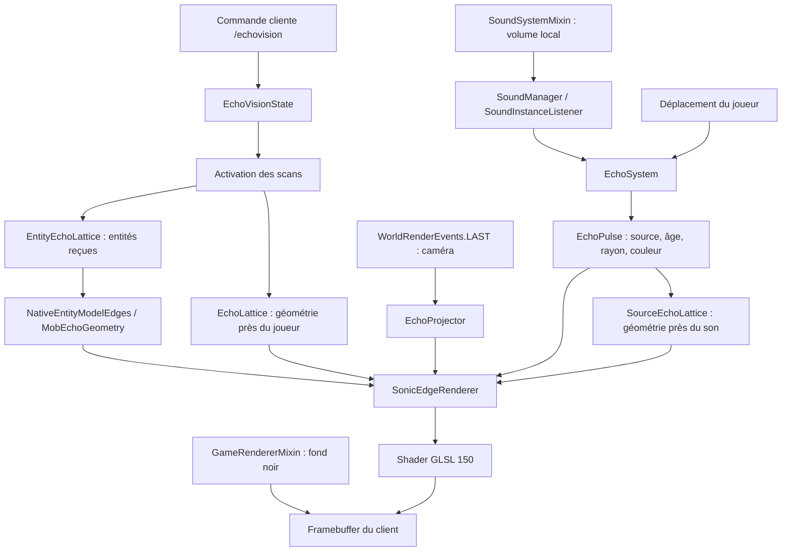

# EchoVision — Dossier technique de référence

**Projet :** EchoVision · **Version archivée :** 2.5.0 · **Auteur :** Thomas_Draco  
**Cible :** Minecraft Java 1.21.1 · Fabric Loader 0.16.14+ · Fabric API 0.116.17+1.21.1 · Java 21 · GLSL 150  
**Type :** mod strictement client-side, vision acoustique procédurale

> Ce document décrit le fonctionnement **réel du code source de la version 2.5.0**. Il vise à servir de référence pour d'autres projets de rendu Fabric/GLSL, indépendamment de la page Modrinth. Il ne constitue pas une preuve de compatibilité universelle.

## 1. Concept et comportement

En mode actif, le rendu du monde normal est effacé et remplacé par un fond sombre. Les sons joués côté client produisent des impulsions localisées dans l'espace. Leurs fronts d'onde révèlent les discontinuités géométriques de l'environnement (arêtes de cubes, escaliers, dalles, poteaux, etc.), une crête sur certaines surfaces ainsi que des silhouettes d'entités proches.

La perception est **événementielle**, non permanente : le monde ne réapparaît pas sous forme de texture normale. Les sons et les déplacements du joueur produisent une succession d'échos. La quantification en pixels est calculée dans le fragment shader, non par une surcouche de bruit sur l'image.

**Contrôles :** `/echovision on` et `/echovision off` ; réinitialisation automatique à la déconnexion ; désactivé par défaut. Aucune sauvegarde de l'état.

## 2. Chaîne fonctionnelle



### Ordre d'exécution simplifié

1. `EchoVisionClient.onInitializeClient()` installe les callbacks Fabric et les hooks de rendu.
2. `ClientCommandRegistrationCallback` enregistre `/echovision` **côté client**.
3. Un tick client enregistre le `SoundInstanceListener` lorsque `SoundManager` existe, puis met à jour les impulsions et maillages.
4. Un son accepté par le moteur sonore est filtré et converti en `EchoPulse` ; les pas du joueur peuvent aussi produire un écho local.
5. `WorldRenderEvents.LAST` capture la position, rotation et matrice de projection de la caméra.
6. `GameRendererMixin` efface la couleur du framebuffer du monde lorsque l'effet est actif.
7. `InGameHudMixin` déclenche le rendu des échos ; le HUD vanilla suit son chemin habituel.
8. `SonicEdgeRenderer` soumet des quads et les uniforms au shader qui décide quels fragments sont visibles.

## 3. Classes et responsabilités

| Composant | Responsabilité |
|---|---|
| `EchoVisionClient` | Point d'entrée client ; commande, callbacks, cycle de vie |
| `EchoVisionState` | Drapeau `volatile` on/off, partagé avec le thread audio |
| `EchoSystem` | Interception des sons joués, filtrage, limitation de fréquence, pas locaux, création d'impulsions |
| `EchoPulse` | Données immuables : origine, couleur, fréquence, intensité, horodatage, vitesse, rayon maximum, entité source |
| `SculkSoundProfile` | Classification par type de son et palette chromatique |
| `EchoLattice` | Arêtes du voisinage du joueur ; reconstruction périodique |
| `SourceEchoLattice` | Arêtes et surfaces autour de chaque **source sonore** ; cache par impulsion et position |
| `VoxelEdgeRules` | Décision topologique : arête visible ou plan continu |
| `VoxelShapeMesher` | Extraction des volumes composés et des vraies ruptures géométriques |
| `VoxelWorldProbe` | Occupation des formes dans les blocs adjacents ; suppression des coutures |
| `EntityEchoLattice` | Sélection d'entités candidates, cache et priorités |
| `NativeEntityModelEdges` | Extraction des cuboïdes de modèles natifs compatibles |
| `MobEchoGeometry` | Morphologies approximatives de secours pour les entités |
| `EchoProjector` | Projection de coordonnées du monde vers l'écran |
| `SonicEdgeRenderer` | Préparation du dessin de quads, sélection des échos, uniforms GLSL, occlusion approximative |
| `SoundSystemMixin` | Amplification locale des sons déjà reçus, sans modifier le volume des catégories muettes |
| `GameRendererMixin` | Effacement de l'image 3D normale tant que le mode est actif |
| `InGameHudMixin` | Appel du rendu acoustique avant le HUD habituel |

## 4. Modélisation des sons

### 4.1 Sources reçues

`EchoSystem` implémente `SoundInstanceListener`. Un événement fournit une position, une catégorie et un volume. Les catégories musique, disques, voix, master et météo sont exclues des échos dans cette version ; les autres sont filtrées selon leur intensité et la fréquence d'occurrence. Les sons positionnels déjà reçus ne sont pas récupérés au-delà des limites de diffusion du jeu ou du serveur.

Le rayon de prise en compte des événements reçus est plafonné à **56 blocs** depuis le joueur (`MAX_HEARING`). Cette valeur ne modifie **pas** la distance à laquelle un serveur transmet les événements sonores.

L'émetteur vivant est identifié par recherche d'entité proche de la position du son pour certaines catégories ; il s'agit d'une **association heuristique**, non d'un identifiant fiable fourni pour tout son.

### 4.2 Structure d'une onde

`EchoPulse` stocke les paramètres nécessaires au rendu. Un front sphérique idéal satisfait :

\[r(t) = \min(r_{max}, v\,\Delta t)\]

avec `Δt = (nowNanos - bornNanos) / 10^9`. L'âge est basé sur `System.nanoTime()`, indépendamment des FPS. Le rayon max. vaut **22 blocs** pour les échos locaux et **22 à 36 blocs** pour les sons externes selon leur intensité. Les vitesses déclarées sont d'environ **10,8 blocs/s** (local) et **15 blocs/s** (externe), choisies pour l'esthétique plutôt que pour reproduire la vitesse acoustique réelle.

Les impulsions périmées sont éliminées périodiquement et la file est bornée à **8** événements. Une impulsion initiale peut apparaître à l'activation de l'effet, puis des impulsions liées aux pas.

## 5. Géométrie voxel : éviter les carrés par bloc

### 5.1 Règle des quatre quadrants

Pour chaque arête candidate dans la grille, `VoxelEdgeRules.isFeatureEdge(a,b,c,d)` examine quatre cellules occupant les quadrants autour de cette arête.

- **0 ou 4 quadrants occupés :** rien à dessiner (vide ou matière pleine).
- **2 quadrants adjacents :** surface plane continue ; joint interne supprimé.
- **1 ou 3 quadrants occupés :** vrai changement de plan ; arête conservée.
- **2 quadrants opposés :** contact diagonal ; arête conservée.

Conséquence : un mur constitué de 25 blocs ne crée pas les 25 cadres de faces. Les arêtes visibles proviennent des reliefs, des limites de la matière et des discontinuités de volumes.

### 5.2 Blocs non cubiques

Les `VoxelShape` peuvent être constituées de plusieurs AABB. `VoxelShapeMesher` récupère les plans de coupe des volumes et reconstruit leur union géométrique ; `VoxelWorldProbe` interroge également les voisins pour supprimer les coutures entre formes continues. Cette approche s'applique aux dalles, marches d'escaliers, clôtures, murs, vitres, portes, trappes et autres formes de collision/contour.

La représentation reste limitée à la forme voxel disponible dans le client ; elle ne correspond pas nécessairement aux triangles exacts du modèle rendu, notamment pour les blocs décoratifs et les modèles personnalisés.

### 5.3 Deux scanners complémentaires

`EchoLattice` tient à jour la topologie autour du joueur (rayons approximatifs **21 × 13 × 21 blocs**). `SourceEchoLattice` reconstruit les arêtes **et des surfaces** autour des origines sonores (rayons approximatifs **13 × 10 × 13 blocs**). Les sources sont précalculées progressivement (au plus une nouvelle par tick) et réutilisées brièvement par cache de position pour éviter de bloquer le rendu.

## 6. Entités

`EntityEchoLattice` sélectionne jusqu'à **28 entités** éligibles par analyse et actualise son cache au plus toutes les deux ticks. Il privilégie les entités susceptibles d'émettre les sons actifs, puis les entités proches du joueur.

`NativeEntityModelEdges` tente de récupérer les cuboïdes des `ModelPart` d'un `LivingEntityRenderer` (`SinglePartEntityModel` / `CompositeEntityModel`), de leur appliquer les poses disponibles et de les transformer en segments du monde. Quand la méthode échoue ou qu'un modèle ne publie pas ces parties, `MobEchoGeometry` produit une approximation anatomique (corps, tête, pattes, etc.).

Les entités **silencieuses** peuvent être illuminées lorsqu'une onde passe sur leur géométrie. Le rendu utilise des tests de ligne de vue pour limiter les silhouettes à travers les murs, mais ce n'est **pas** une gestion complète de l'occlusion par profondeur GPU. Les animations natives peuvent être approximées, notamment avec des renderers tiers.

## 7. Pipeline de rendu et shader

### 7.1 Côté CPU

`EchoProjector` convertit les segments 3D en coordonnées écran à partir de la position et de la rotation de la caméra, ainsi que de la matrice de projection récupérée pendant le rendu du monde.

`SonicEdgeRenderer` convertit chaque segment projeté en un quad étroit (`POSITION_TEXTURE_COLOR`). Il alimente les attributs et uniforms GLSL :

| Variable | Signification |
|---|---|
| `UV0.x` | Distance 3D entre un point de géométrie et la source du son, interpolée |
| `UV0.y` | Position transversale sur le ruban (-1 à 1) |
| `WaveRadius` | Rayon courant de l'onde, en blocs |
| `WaveAge` | Âge de l'onde, en secondes |
| `WaveStrength` | Intensité corrigée par l'atténuation |
| `WaveColor` | Couleur acoustique courante |
| `PixelSize` | Taille cible de cellule en pixels physiques |
| `SurfaceMode` | `0` : ruban sur arête ; `1` : crête sur surface |

Le rendu efface la couleur du monde et repasse ensuite par le pipeline GLSL. Le HUD du jeu reste visible. Aucune texture du monde normal n'est réinjectée par le mod.

### 7.2 Côté GPU

Les deux fichiers centraux sont :

```text
assets/echovision/shaders/core/sonic_edge.json
assets/minecraft/shaders/core/echovision_sonic_edge.vsh
assets/minecraft/shaders/core/echovision_sonic_edge.fsh
```

Le programme est enregistré sous `echovision:sonic_edge` via `CoreShaderRegistrationCallback`. Le fichier JSON définit les attributs, le nom des programmes GLSL et leurs uniforms. Le vertex shader transforme les points et transporte les données interpolées ; le fragment shader sélectionne les points atteints par le front d'onde.

Schématiquement :

```glsl
vec2 cellCenter = (floor(gl_FragCoord.xy / PixelSize) + 0.5) * PixelSize;
// Quantification spatiale stable sur la géométrie, pas bruit écran.
float d = floor(distanceBlocks * 8.0 + 0.5) / 8.0;
float crest = 1.0 - smoothstep(0.18, 0.78, abs(d - WaveRadius));
```

Ces lignes illustrent la logique du shader, pas une routine GLSL autonome. Les dérivées `dFdx`/`dFdy` servent à rééchantillonner les valeurs sur une grille régulière de pixels. La luminosité est discrétisée en paliers ; une décroissance exponentielle fournit la rémanence sur les arêtes déjà traversées. En `SurfaceMode`, seule une bande étroite de passage de l'onde est rendue, pas le rectangle entier de la face.

**Pourquoi ce n'est pas un filtre “noise” :** les fragments visibles naissent exclusivement des objets et de leurs points de surface calculés. La pixelisation concerne le front d'onde, pas une texture pleine page aléatoire.

## 8. Interventions sur le client Minecraft

### 8.1 Commande cliente

L'enregistrement utilise `ClientCommandManager` et `ClientCommandRegistrationCallback` de Fabric API. `/echovision` ne requiert pas `OP` sur le serveur. La valeur on/off est un état local ; la déconnexion le réinitialise. Aucune donnée utilisateur n'est exportée.

### 8.2 Audio

`SoundSystemMixin` modifie le volume ajusté retourné par `SoundSystem` pour les sons admissibles. Les catégories hostiles et joueurs reçoivent un multiplicateur d'environ **1,70** ; les autres sons retenus, **1,43**. Le résultat est plafonné à **1,0** et les sons déjà muets ne sont pas réactivés.

**Ne pas confondre :** amplification **audible** ≠ élargissement de la **portée de diffusion serveur**. La portée de calcul des ondes ne remplace pas le protocole de transmission Minecraft.

### 8.3 Mixins / shaders

- `GameRendererMixin` : efface le buffer couleur du monde après son rendu ; conserve le pipeline de composition du jeu.
- `InGameHudMixin` : appelle l'overlay GLSL avant les éléments vanilla du HUD.
- `SoundSystemMixin` : modifie uniquement le volume côté client.

Le mod ne définit aucun item, bloc, entité, recette, interface réseau personnalisée ou commande serveur.

## 9. Client-only et compatibilité

Dans `fabric.mod.json`, le champ `environment` vaut `client` et le seul entrypoint est `fr.echovision.client.EchoVisionClient`. Le fichier de mixins ne contient que des injections client. **Aucun composant du mod n'a besoin d'être installé sur le serveur.**

Ne pas confondre cette propriété avec une garantie universelle sur tous les serveurs ou modpacks : des réglages serveur peuvent limiter la portée des événements et des mods de rendu concurrents peuvent modifier le framebuffer ou les shaders. Le projet n'a pas été validé contre toutes les combinaisons Iris/Sodium/OptiFine.

## 10. Coût CPU/GPU et contrôles de performance

Les opérations les plus coûteuses sont la reconstruction des voxels de la zone locale, l'analyse des `VoxelShape`, les extractions des parties de modèles d'entités, les tests d'occlusion et le dessin de nombreux quads. Les garde-fous actuels comprennent :

- reconstruction du scanner joueur espacée d'environ **14 ticks** quand le joueur reste dans la même zone ;
- scanner de source préchauffé à raison d'une nouvelle source par tick et caches bornés ;
- maximum de **8 impulsions** simultanées ;
- maximum de **28 entités** par extraction ;
- limite de **4 000 segments** par appel au renderer, avec filtrage sur rayon et champ de projection ;
- cache de visibilité d'entités mis à jour par tick.

Ces plafonds sont des choix de code, **pas** des résultats de benchmark. Pour objectiver le coût, mesurer les temps CPU de `rebuild`, `prewarmOne` et `EntityEchoLattice.tick`, ainsi que le nombre de quads soumis / FPS sous des scénarios reproductibles.

## 11. Stratégie de tests et exemple réutilisable

### Tests géométriques sans Minecraft

`VoxelEdgeRulesSelfTest` est un exécutable Java autonome, indépendant des classes Minecraft. Il teste les 16 masques de quadrants et des assemblages simples (cube, mur plat, volume plus grand). Exécution possible après compilation de la classe correspondante avec `javac`.

### Tests d'intégration à reproduire en jeu

1. `/echovision off` : vérifier l'image et le son vanilla.
2. `/echovision on` : écran sombre, onde initiale, sons et pas visibles.
3. Mur continu : aucune grille de cadres par bloc.
4. Dalles / escaliers / clôtures : contours respectant leur silhouette.
5. Bruit près d'un mob puis d'un mob silencieux : échos autour des deux, selon la portée.
6. Mob derrière un mur épais : vérifier l'absence de contours visibles à travers l'obstacle.
7. Changement de dimension, déconnexion/reconnexion : remise à zéro des caches et de l'état.
8. Forte densité sonore/entités : absence de saccades excessives, surveillance des FPS.
9. Rechargement ressources F3+T : vérification du réenregistrement du shader.

### Modèle réutilisable pour d'autres mods

Séparer en quatre couches :

1. **Sources** (`SoundInstanceListener`, événements, position) : aucune dépendance à l'affichage.
2. **Géométrie** (`VoxelShape`, modèles d'entités, caches) : produire des segments/surfaces neutres.
3. **Projection** (caméra, matrices, clipping) : convertir les coordonnées sans logique métier.
4. **GPU** (GLSL, uniforms, buffers) : déterminer apparence, seuils et animation par fragment.

Ce découplage permet de changer l'événement déclencheur (sort, sonar, explosion), la méthode géométrique ou la direction artistique sans tout réécrire.

## 12. Évolutions possibles

- Capturer la géométrie réelle du moteur de rendu et un buffer de profondeur pour l'occultation exacte, au lieu des tests de ligne de vue simplifiés.
- Prendre en charge les `EntityRenderers` personnalisés et leurs animations interpolées.
- Réduire les allocations de matrices et de listes, gérer des buffers GPU persistants.
- Introduire des options de rendu et un profil de performance sans changer la commande principale.
- Ajouter un banc de tests automatisés Fabric avec vérification des événements de cycle de vie et du chargement GLSL.

## 13. Fichiers à conserver ensemble

```text
src/main/java/fr/echovision/client/
src/main/java/fr/echovision/mixin/
src/main/resources/fabric.mod.json
src/main/resources/echovision.mixins.json
src/main/resources/assets/echovision/shaders/core/sonic_edge.json
src/main/resources/assets/minecraft/shaders/core/echovision_sonic_edge.{vsh,fsh}
build.gradle
gradle.properties
settings.gradle
```

**Important pour l'archivage :** le passage de l'ancien ID `warder` au nouvel ID `echovision` est une rupture d'identifiant Fabric. Toujours retirer les anciennes versions des dossiers `mods` et relancer une compilation complète avec le projet renommé.
